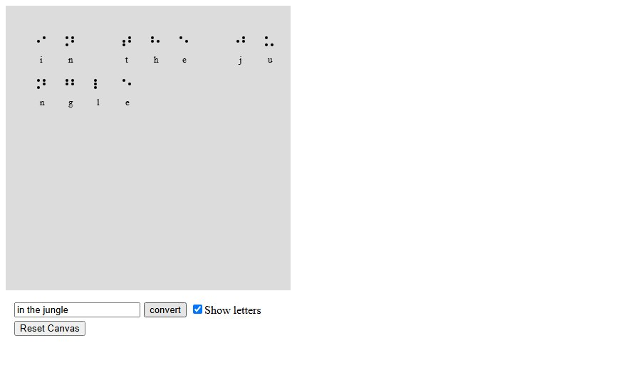
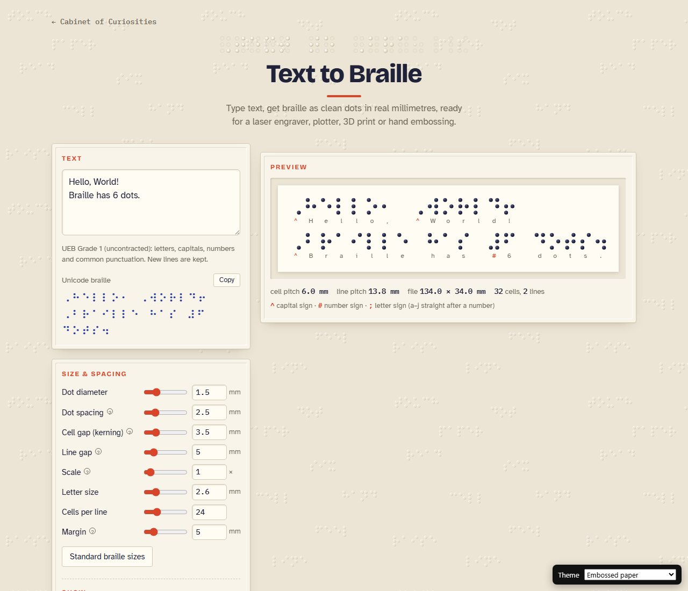
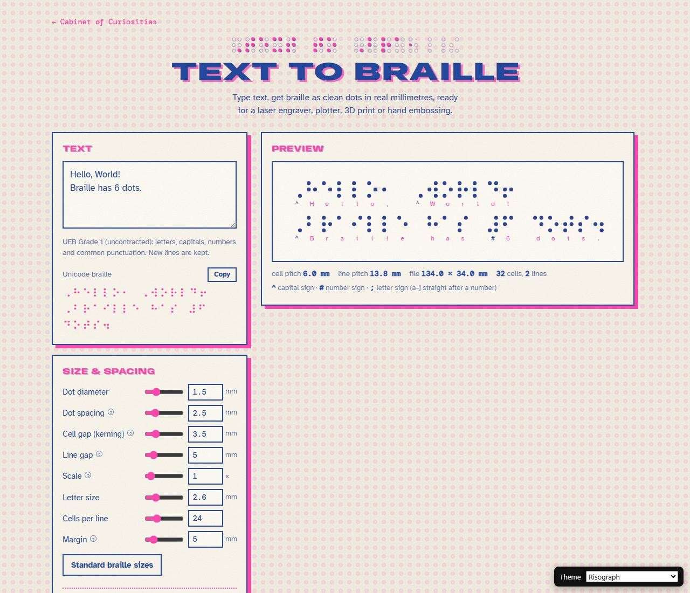
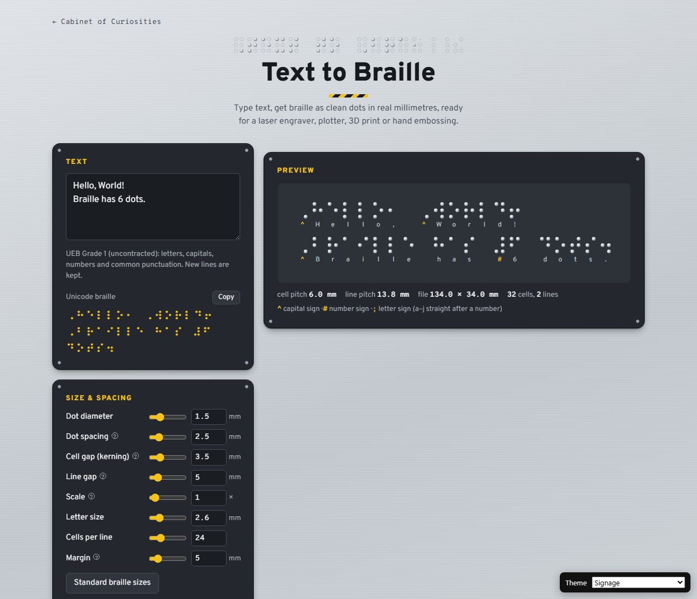
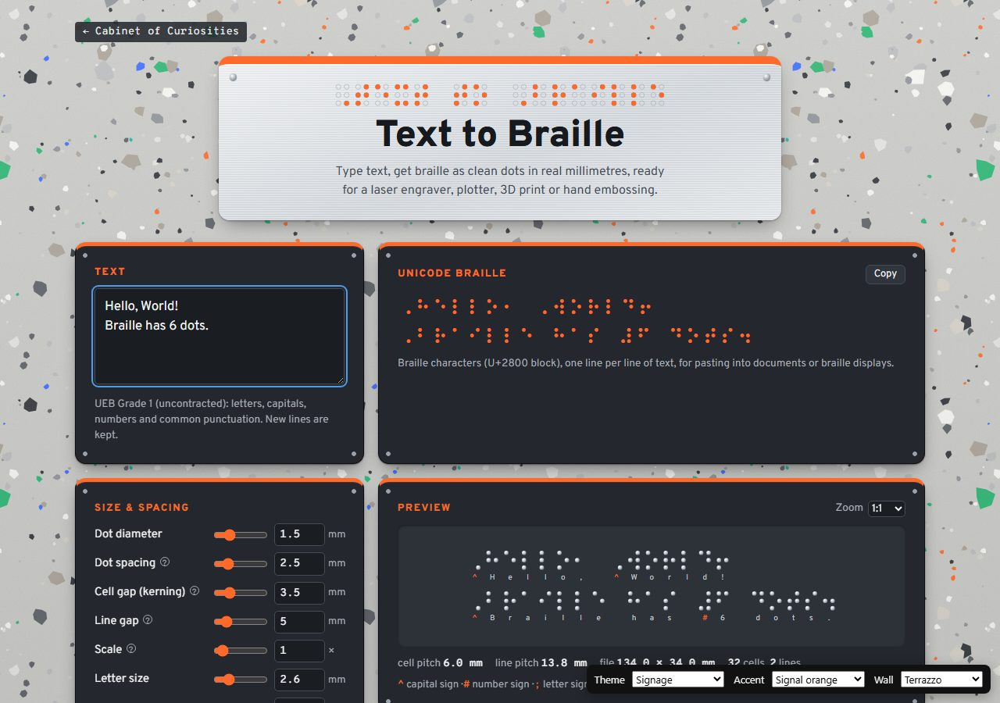
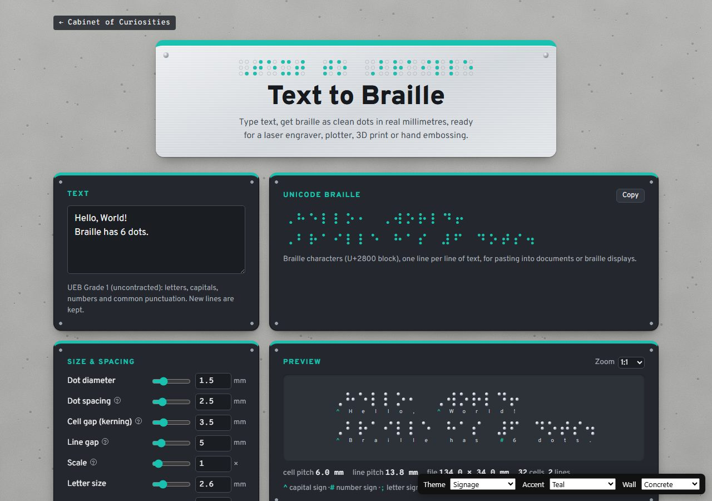
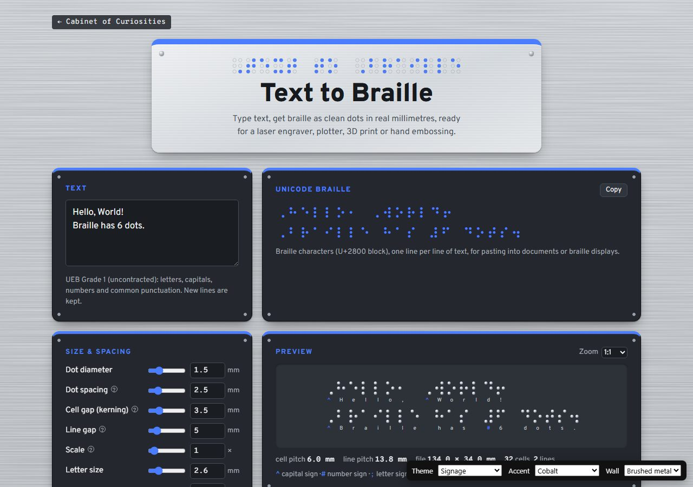
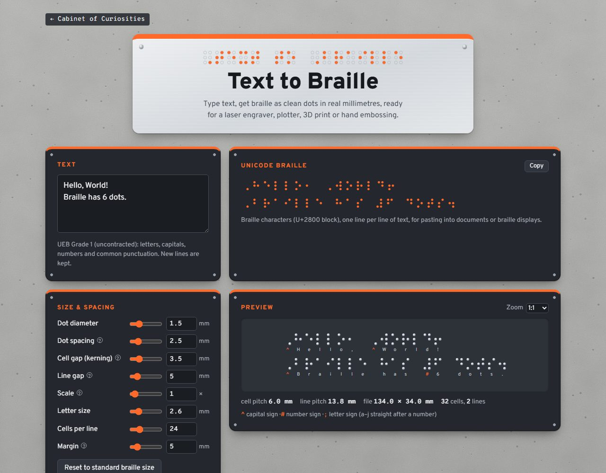
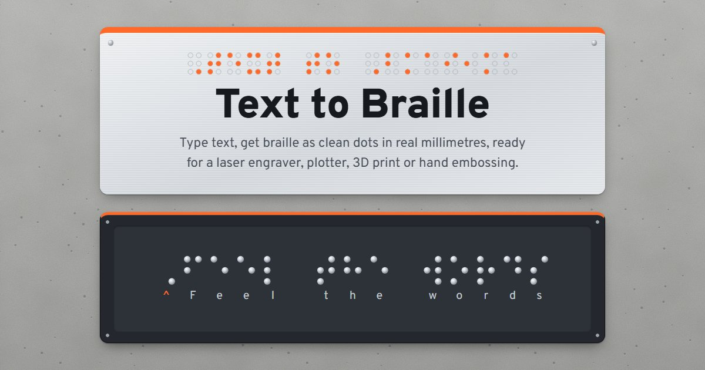
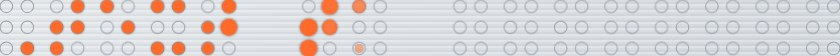

# Text to Braille — visual changelog

How the tool developed, stage by stage, with a screenshot of each in [dev-screenshots/](dev-screenshots/).
The text changelog is in [README.md](README.md#changelog).

---

## 1. p5.js sketch — 2021 / 2024

A 400 × 400 canvas, an input box, convert and reset buttons and a show-letters checkbox. a–z, space and
`. , ?` only; saved as a JPG.

## 2. Rebuilt as an SVG tool, theme trial — 2026-11-22

No p5: UEB Grade 1 translation, a preview in millimetres, size and spacing controls, toggles, SVG / PNG / ZIP
download and Unicode braille. Four themes to choose from (picker at the bottom right).

A fourth theme, Midnight (ResCalc's colours and stepped lines), was rejected straight away and its files
deleted before the first commit, so it has no screenshot.

| Embossed paper | Risograph | Signage |
| --- | --- | --- |
|  |  |  |

## 3. New layout, Signage developed — 2026-11-22

Layout: text | Unicode braille on the first row, controls | preview on the second, the preview staying in view
while the controls scroll (it hadn't been: the themes' `position: relative` on cards beat `sticky`). The preview
now has a fixed zoom (1:1 default) instead of always fitting the card width, so dots no longer shrink as text is
added. Signage gets a coloured accent instead of mustard, a light aluminium title sign, accent stripes on the
plates, and a textured wall — accents and walls switchable for comparison.

| Signal orange, terrazzo | Teal, concrete | Cobalt, brushed metal |
| --- | --- | --- |
|  |  |  |

## 4. Look settled: signal orange on concrete — 2026-11-22

The trial closed: Signage with the signal-orange accent on the concrete wall, kept as `theme.css`; the other
themes and the picker removed. The title's braille now presses up, holds and sinks back every 8 seconds instead
of once. Link-preview image added.

| Link preview (`og-preview.jpg`) |
| --- |
|  |

## 5. Mushroom-pop title dots — 2026-11-22

The title's braille dots pop up like cartoon mushrooms: they grow past full size (1.4×), plop back a
touch under (0.9×) and settle; on the way down they puff up (1.25×) and shrink away to nothing. Frozen
mid-wave below: settled dots on the left, overshooting ones in the middle, some still emerging.

